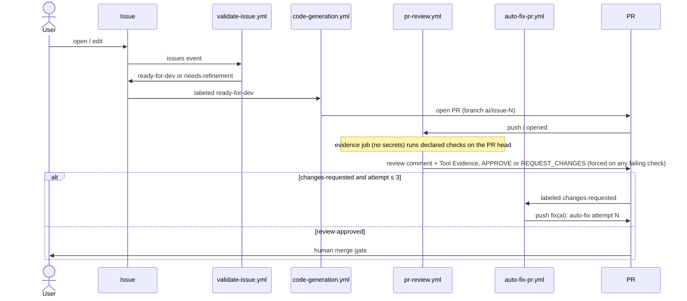

# Code Generation MVP Setup

This repository includes an MVP workflow that converts validated issues into AI-generated draft pull requests. The default AI provider is **Groq** with stage-specific defaults: all four stages (`validation`, `generation`, `review`, `autofix`) use `openai/gpt-oss-120b` with `reasoning_effort: low` (ADR-0025). Anthropic (Claude models) is also supported. With both keys configured, `AI_PROVIDER` picks the primary provider and the other one is the automatic fallback (ADR-0032). The workflow triggers automatically when the validation agent applies the `ready-for-dev` label.

## Quick Start (Operator)

For a first-time setup, complete these steps in order:

1. Configure required secrets in **Settings → Secrets and variables → Actions**:
   - `ANTHROPIC_API_KEY` and/or `GROQ_API_KEY`
   - `AI_PR_TOKEN` (recommended for reliable PR/label/review writes)
2. (Optional) Configure provider variables:
   - `AI_PROVIDER` — `anthropic` or `groq`: the primary provider. Unset or blank: Anthropic when only `ANTHROPIC_API_KEY` is set, Groq otherwise. An unknown value uses that same default, and a provider whose key is missing yields to the one that has a key; both log a `provider_config_fallback` warn event and never fail the job. The other provider is the fallback when its key is set: it is called with its own key, model and stage settings on any primary failure, 401/403 included, and each fallback logs an `llm_fallback` event (`error` level, with a GitHub annotation, on 401/403 and 400/404; `warn` otherwise) (ADR-0032). A Groq call is only made when the prompt fits Groq's `<stage>_max_input_tokens`: otherwise it is skipped rather than retried into a 413 until the job timeout — an over-budget Groq primary goes to the Anthropic fallback, and an Anthropic primary does not fall back to Groq (`groq: skipped (prompt ~N tokens over …)`).
   - `AI_PROVIDER_VALIDATION`, `AI_PROVIDER_GENERATION`, `AI_PROVIDER_REVIEW`, `AI_PROVIDER_AUTOFIX`, `AI_PROVIDER_CONFLICTS` — `anthropic` or `groq`: the primary provider of that stage only, over `AI_PROVIDER` (ADR-0032 amendment 2026-10-17). Unset or blank: `AI_PROVIDER`. Same rules: an unknown value yields to the repo-wide provider, a provider without its key to the one that has a key, each with one `provider_config_fallback` warn event (`meta.variable` names the variable). The fallback is the other provider, with its own stage config. Move a stage only once its eval suite passes on that provider and model ([docs/evals.md](evals.md#measuring-a-model)).
   - `ANTHROPIC_MODEL` — Anthropic model for **every** stage, production included (unset: `anthropic_<stage>` in `config/models.yaml`: validation `claude-haiku-5-5`, generation, review and autofix `claude-sonnet-5-5`). Leave it unset to keep the per-stage models; to measure a model, use the `evals.yml` `anthropic_model` input instead.
   - `ANTHROPIC_EFFORT` — `low` | `medium` | `high` | `xhigh` | `max` overrides `anthropic_<stage>_effort` for every stage (sent as `output_config.effort`); `off` sends none. Set `off` when `ANTHROPIC_MODEL` is Sonnet 4.5 or Haiku 4.5 (they reject `effort`, every call would 400), and avoid `xhigh`/`max` on Opus 4.5. `off` is rejected (the stage fails before any call, naming `ANTHROPIC_EFFORT` or the `anthropic_<stage>_effort` key) for `claude-opus-5-5` and `claude-sonnet-5-5`: they cannot disable thinking, and without an effort they run at their default (medium / high). Use `low` there.
   - `GROQ_MODEL` — Groq model name override for all stages (if unset, stage defaults from `config/models.yaml` are used: `openai/gpt-oss-120b` for every stage). If you point it at a non-reasoning model, also set `GROQ_REASONING_EFFORT=off`.
   - `GROQ_REASONING_EFFORT` — `low` | `medium` | `high` overrides `<stage>_reasoning_effort` for every stage; `off` stops sending `reasoning_effort` (required for non-reasoning `GROQ_MODEL` overrides). Unset: per-stage values from `config/models.yaml` (ADR-0025).
   - `GROQ_API_URL` — Groq endpoint URL (defaults to `https://api.groq.com/openai/v1/chat/completions` if unset).

### Per-workflow environment variable matrix

All four workflows pass both provider key sets, so provider selection is driven entirely by which secrets are configured in the repository — no workflow-level override is needed.

| Workflow | Required secret(s) | Optional variables | Fallback |
|---|---|---|---|
| `validate-issue.yml` | `ANTHROPIC_API_KEY` or `GROQ_API_KEY` | `AI_PROVIDER`, `AI_PROVIDER_VALIDATION`, `ANTHROPIC_MODEL`, `ANTHROPIC_EFFORT`, `GROQ_MODEL`, `GROQ_REASONING_EFFORT`, `GROQ_API_URL` | Fails with clear error if neither key is present |
| `code-generation.yml` | `ANTHROPIC_API_KEY` or `GROQ_API_KEY` | `AI_PROVIDER`, `AI_PROVIDER_GENERATION`, `ADL_LESSONS` (`off` disables the active lessons, ADR-0051), `ANTHROPIC_MODEL`, `ANTHROPIC_EFFORT`, `GROQ_MODEL`, `GROQ_REASONING_EFFORT`, `GROQ_API_URL` | Fails with clear error if neither key is present |
| `pr-review.yml` | `ANTHROPIC_API_KEY` or `GROQ_API_KEY` | `AI_PROVIDER`, `AI_PROVIDER_REVIEW`, `ANTHROPIC_MODEL`, `ANTHROPIC_EFFORT`, `GROQ_MODEL`, `GROQ_REASONING_EFFORT`, `GROQ_API_URL` | Fails with clear error if neither key is present |
| `auto-fix-pr.yml` | `ANTHROPIC_API_KEY` or `GROQ_API_KEY` | `AI_PROVIDER`, `AI_PROVIDER_AUTOFIX`, `ADL_LESSONS` (`off` disables the active lessons, ADR-0051), `ANTHROPIC_MODEL`, `ANTHROPIC_EFFORT`, `GROQ_MODEL`, `GROQ_REASONING_EFFORT`, `GROQ_API_URL` | Fails with clear error if neither key is present |

`AI_PR_TOKEN` is used only by `code-generation.yml`, `pr-review.yml`, and `auto-fix-pr.yml` for GitHub API write operations.

## GitHub Actions PR Permission Requirement

If the run fails with:

`GitHub Actions is not permitted to create or approve pull requests.`

you have two supported options:

1. Enable repository setting **Settings → Actions → General → Workflow permissions → Allow GitHub Actions to create and approve pull requests**.
2. Set `AI_PR_TOKEN` and keep the setting disabled (recommended for stricter org policies).

## Required Label

The validation workflow creates and manages these labels automatically:

- `ready-for-dev` — applied when issue quality is sufficient; triggers PR generation.
- `needs-refinement` — applied when the issue requires clearer acceptance criteria.

The PR review workflow creates and manages these labels automatically:

- `review-approved` — applied when the automated code review verdict is APPROVED.
- `changes-requested` — applied when the automated code review verdict is REQUEST_CHANGES.
- `review-withheld` — applied when the model approved but the tool evidence is unverified (ADR-0026); does not trigger auto-fix and is cleared by the next verdict.

All label names, colors, and descriptions are configurable in `config/labels.yaml`.

## Generation Guardrails

`prompts/generation-system.md` and `prompts/generation-user.md` enforce the following beyond the base JSON contract:

- **Dependency allowlist:**
  - the prompt consumes an "Allowed npm dependencies" context block as the exhaustive list of external packages the model may import from — any import outside it must be a relative project import or a language/runtime built-in (e.g. `AbortController`, `fetch` need no import at all; `fs`, `path`, `node:*` modules need an import but never an npm install).
  - `scripts/lib/file_injector.mjs`'s `buildFileContentsBlock()` (used by `generate_issue_change.mjs`) implements the injection: it reads the target repository **root**'s `package.json`, when present, merging `dependencies`, `devDependencies`, `peerDependencies`, and `optionalDependencies`, and prepends the formatted block ahead of the existing file-context block.
  - Absent or malformed `package.json` resolves to no allowlist block (not an error), since this pipeline is also used against non-Node.js repositories — but a *readable* `package.json` that declares zero dependencies still emits an explicit "no dependencies declared" block rather than staying silent, since the model needs to be told an empty allowlist is exhaustive too (this repository, with no runtime npm dependencies, is exactly that case).
  - The list is capped at 200 entries AND 4000 characters — whichever limit is reached first (truncated alphabetically with a note for larger manifests), since a manifest with fewer but long scoped package names could otherwise stay under the entry cap while still ballooning the prompt.
  - This is a self-contained bound; the generation stage doesn't otherwise cap/truncate its input by token budget the way the auto-fix stage does (`autofix_max_input_tokens`).
  - The list reflects the root manifest only — it doesn't supersede the separate rule allowing a package already imported elsewhere in the target file, and it may not cover nested workspace-package manifests in a monorepo.
- **Test-writing is issue-driven, not path-driven:** a test file is required whenever the issue explicitly requests one, or whenever the change introduces new non-trivial logic (a function, class, hook, component, or endpoint) — regardless of the target file's path. This is broader than the pre-existing `scripts/`/`prompts/`/`.github/workflows/` coverage-policy scoping described above, which still applies additionally to those paths.
- **Self-check before returning:** the generation prompt requires the model to trace through the primary success scenario from the issue and verify (a) no assignment targets a known read-only/getter-only built-in property (e.g. `AbortController.prototype.signal`), and (b) any value meant to persist across calls/renders is stored via `useRef`/module state/a class field rather than a re-initialized local variable.

These were added after a benchmark session found a local coding model violating the dependency guardrail and producing a guaranteed-crash read-only-property bug that the paired PR-review prompt did not catch — see [ADR-0019](adr/0019-static-verification-backstop.md).

## Guardrails Enforced in Code (both stages)

The prompt rules above are backed by `scripts/lib/static_verifier.mjs` (ADR-0019), called by `generate_issue_change.mjs` and `auto_fix_pr.mjs` after `validateAiOutput()` and before `writeGeneratedFiles()`. `findGuardrailViolations()` runs, per changed file:

| `rule` | Rejects |
|---|---|
| `withheld_file`, `unshown_file` | an existing file the model did not see in full (ADR-0029). Generation shows the files the issue names, each in full or as a `File withheld … do NOT target this file` marker above 8,000 chars |
| `mass_deletion`, `test_count_drop` | removing more than `max(20, 30%)` of a file's non-blank lines; a test file whose `test(`/`it(` count drops (ADR-0029) |
| `module_system` | `require(` added to an `.mjs` file; a `.cjs` (or CommonJS `.js`) file converted to ESM; `require(` added to an ESM `.js` file |
| `exported_signature` | an exported function removed (always), or whose arity, parameter names/shape or sync/async changes — unless the issue (generation) or the review feedback (auto-fix) names the function |
| `unresolved_import` | an added import that is not a Node builtin, not a relative path existing after the patch, and not a package from `package.json` (snapshotted before the LLM call) or already imported by the file |

The write denylist and the shrink guard (ADR-0021) still run inside `validateAiOutput()` / `writeGeneratedFiles()`. Any rejection is one `GuardrailError`: nothing is written. On auto-fix it follows the `Auto-Fix: Patch Rejected` path below. On generation, the issue gets a `Code Generation: Patch Rejected` comment (rules + reason per file) and `needs-human`, a `codegen_skip` metric records `rules`, the run exits 0 with `rejected=true` and `code-generation.yml` opens no PR. Fix the issue text (name the function whose signature must change, the file to edit) or implement by hand, then remove `needs-human` and re-apply `ready-for-dev`.

### Protected paths: floor plus per-repository config (ADR-0044)

The denylist is the union of a hard-coded floor and `config/protected-paths.yaml`:

- **Floor** (`scripts/lib/protected_paths.mjs`, never overridable): `.git/`, `.github/`, `config/protected-paths.yaml`, Node manifests, lock files and `.npmrc`/`.yarnrc*`, .NET (`*.csproj`, `*.fsproj`, `*.vbproj`, `Directory.Packages.props`, `Directory.Build.props|targets`, `NuGet.config`, `global.json`, `packages.lock.json`) and Python (`requirements*.txt`, `pyproject.toml`, `poetry.lock`, `setup.py`, `setup.cfg`, `Pipfile`, `Pipfile.lock`, `uv.lock`, `pip.conf`). The ADR lists and justifies each one.
- **Repository list:** `protected_paths:` in `config/protected-paths.yaml`, a `- entry` list or `[]`. Forms: `dir/` (root-level directory), `a/b.json` (exact root path), `name` (file name at any depth, one `*` allowed: quote it, `"*.gen.cs"`). A repository adds entries; nothing can remove a floor entry. This repository lists `scripts/`, `config/`, `prompts/`, `checkpoints/`, `metrics/`, `observability/`, `docs/`, `README.md`; a test fails if one is dropped.
- **No file** means floor only. **Invalid content** (unknown key, bad entry, glob outside a file name, …) fails at startup of every script importing `output_writer.mjs`, with `config/protected-paths.yaml: protected_paths[<i>] …`. The file is read from the default branch (ADR-0023): a PR editing it takes effect once merged.
- Both system prompts list the floor and this repository's entries; when you change the list, update `prompts/generation-system.md` and `prompts/auto-fix-system.md` (`smoke.test.mjs` fails otherwise).

## Blocked Outcome (ADR-0029 amendment)

When generation cannot implement an issue it opens **no PR**. Before this, it wrote a Markdown handoff note instead (#191 for issue #190: `notes/issue-190-blocked.md`; #196 for #195: `patches/issue-195-dependency-manifest.md`), the review bot approved it, and merging it would have closed the issue. `scripts/lib/generation_blocked.mjs` decides, in this order (first match wins):

| `source` | Check | When |
|---|---|---|
| `denylist` | deterministic, from the issue text before the LLM call | every path the issue needs is protected (ADR-0021) or withheld from the prompt (ADR-0029). Needed paths: the paths the issue names, URLs removed; a candidate with a `/` counts only when it exists in the repository or ends in a file extension (`.csproj` as much as `.mjs`; prose such as `retry/fallback` or `401/403` is not a path), with a leading dot restored (`.github/…`); a bare file name only when it exists at the repository root and is not the base name of a path also named; the root `CHANGELOG.md` is a companion and never counts. An issue that names no path, or any writable one, is not blocked here |
| `model` | structured signal in the generation output | `"blocked": true` (the JSON boolean), with `blocked_reason` and `planned_fix`, `changes: []`. Text in `summary` is never read as a signal; any other `blocked` value is a malformed response and fails the run |
| `notes_only` | deterministic, on the model output | the issue is labelled `bug` or `feature` and every changed file is a **new** `.md` file outside `docs/` |

Precedence: the repository facts win, so a model answering `blocked: false` (or writing a note) cannot override the deterministic check, and an injected issue body cannot argue its way past it. The model is only trusted to *add* a blocker the code cannot see (an issue declaring itself blocked by an unmerged PR). The LLM is still called when the deterministic check fires, because the comment needs the model's planned fix.

On blocked: nothing is written, the issue gets a `Code Generation: Blocked` comment (source, reason, and the planned fix: `planned_fix`, else the content of the note the model wrote, else its summary, capped at 4,000 chars), `ready-for-dev` is replaced by `needs-human`, a `codegen_skip` metric records `reason: "blocked"` and `source`, `code_gen.skipped` is logged with `reason: "blocked"` and `duration_ms`, and the run exits 0 with `blocked=true`. `code-generation.yml` skips **Create pull request**, so no branch is pushed. The workflow passes the issue's labels as `ISSUE_LABELS` (JSON array). If a GitHub call of the escalation fails, the run ends with `code_gen.error` (`reason: "blocked"`) and exits 1.

To resume: merge the dependency or implement the protected part by hand, then remove `needs-human` and re-apply `ready-for-dev`.

## Step Outputs (`GITHUB_OUTPUT`)

Step outputs carry untrusted text: the validation comment and the generation / auto-fix `summary` (model output), the issue body and title. A heredoc with a fixed delimiter (`EOF`, `__DELIM__`) let a value line equal to it close the block and forge the following lines as outputs (`valid=true` dispatching code generation, an injected `fixed_paths` / `attempt_number`), or fail the step on a stray line (2026-10-19 audit F04, F28).

- **Scripts** write every output through `scripts/lib/github_output.mjs` (`appendOutputs`): a value without a line break is `name=value`; any other value is a heredoc whose delimiter is `ghadelim_<uuid>`, drawn per write and redrawn while the value contains it; `\r\n` / lone `\r` become `\n`; an invalid name throws before anything is written. Multi-line values are written first and single-line control outputs (`valid`, `score`, `attempt_number`, `rejected`, `blocked`) last, so the runner's last-value-wins can only favour them. A single path in `generated_paths` / `fixed_paths` is written as `name=value` (same value for consumers).
- **`adl-code-generation.yml` → Resolve issue data** draws `DELIM="ghadelim_$(openssl rand -hex 16)"` per run for the issue `body` and `title` heredocs, then writes `number` and `labels`. The body is read by `gh` at runtime, never interpolated into the script. An issue body containing `__DELIM__` no longer fails the step.
- `workflow_gates.test.mjs` fails on any workflow writing a fixed heredoc delimiter with `echo` / `printf`.

## Review and Auto-Fix Guardrails

`prompts/pr-review-system.md` (with `prompts/pr-review-repo-rules.md`, see below) and `prompts/auto-fix-system.md` enforce the following beyond the base rubric:

- **Test-coverage gate is not limited to automation paths:** whenever the diff's classification context reports `tests_expected: true` (any feature/bugfix/refactor change, regardless of path — not just `.github/workflows/`, `scripts/`, `prompts/`), the reviewer checks the `has_test_file_changes` field (computed from the full PR diff, independent of the truncation below — and only counting test files actually added/modified, not ones only deleted) rather than only what's visible in the diff text, reporting at least MEDIUM severity when it's false. This closes a gap where a diff could self-classify "Tests expected: yes" and still be `APPROVED` with no tests present. `has_test_file_changes: true` is a coarse signal, not proof of relevant coverage — when the test file's content is visible in the diff, the reviewer still judges whether it plausibly covers the new/changed logic rather than treating the boolean as conclusive, except when `diff_truncated` makes that judgment impossible.
- **Coverage gate (c) reads the c8 gates, not the diff (ADR-0033):** `pr-review-repo-rules.md` states the rule and names no module: the automation gates context (`buildAutomationGateContext`) adds a `gated_files_changed` line with the changed files that are in `config/coverage-gates.json`, the one list of the c8 gates (80% lines, branches, functions, statements), which `node scripts/coverage_gates.mjs` runs as the single coverage step of `test.yml`. A changed file named on that line satisfies the coverage gate even though neither `test.yml` nor the config is in the diff. The reviewer reports HIGH only when the diff removes an entry from the config or lowers its threshold, and MEDIUM when the diff adds a `scripts/lib/*.mjs` module without an entry. Other automation files are judged on their tests (gate (a)). Before this, the prompt named only `checkpoint.mjs` and reported a false HIGH "missing coverage policy" on any other gated module (PR #184). `workflow_gates.test.mjs` fails when the prompt's list and the config drift apart (`node scripts/coverage_gates.mjs --sync` rewrites the prompt's list).
- **Named defect checklist:** the reviewer explicitly checks every new/changed file for three specific patterns rather than relying on open-ended "look for bugs" judgment: read-only/getter-only property assignment (e.g. `AbortController.prototype.signal`), unauthorized dependency imports, and non-persistent "ref" patterns (state meant to survive across calls/renders stored in a re-initialized local variable instead of `useRef`/module state).
- **Verdict parsing:** `pr_review.mjs` reads the verdict after the word `Verdict` in any of these forms: `### 🚀 Verdict` on its own line, `Verdict: APPROVED`, a bold verdict (`**APPROVED**`), a bold heading (`**🚀 Verdict**`) or a bold heading with colon (`**Verdict:** APPROVED`). Anything else — the template placeholder, prose, or no verdict — is treated as `REQUEST_CHANGES`. Unit-test coverage: 100% of these forms, both verdicts where they apply (AGENTS.md, Test Coverage Policy).
- **Truncated-diff disclosure:**
  - `pr_review.mjs` bounds the diff shown to the model by the provider's limit: on Groq the `review_max_input_tokens` budget, on Anthropic (no input budget) `anthropic_review_max_diff_chars`, 200,000 characters (ADR-0038 amendment 2026-10-19; it was 12,000 before).
  - Before that bound, unchanged context lines inside hunks are cut to 200 characters with a visible ` …[+N chars]` marker, so long context (e.g. a 1–2k-char CHANGELOG entry) does not use up the budget. `+`/`-` lines and file/hunk headers are never cut, and this context cut alone never sets `diff_truncated`.
  - When that bound actually cuts content, a `diff_truncated: true` field is added to the classification context and the reviewer is required to disclose in its output that only a partial diff was inspected, rather than implying full coverage in an unqualified `APPROVED`.
  - When the cut reaches code (a file that is neither a test nor documentation), an `APPROVED` is not submitted as an approval: the verdict is `WITHHELD`, with `review-withheld` and a note naming the files (ADR-0038). A cut that removes only tests or documentation does not change the verdict.
  - Both cuts (the Anthropic char cap and the Groq token budget) end on a whole line, preferably a hunk boundary, never inside a line or on a bare header, and are followed by a `… [diff cut: N more lines not shown, in <files>]` marker (`(partly shown)` for a file cut mid-way, which counts as unreviewed).
  - A model `REQUEST_CHANGES` whose findings all cite only cut code files is posted as `WITHHELD` too ("Changes not requested", no auto-fix); a failing check, or any finding on a shown file, keeps it `REQUEST_CHANGES` (ADR-0038 amendment, #219).
- **Findings the fixer can act on (ADR-0034):** every finding must cite a file and lines in the diff shown, and its fix must not require editing an existing file whose hunks the reviewer did not see (the auto-fixer only edits files it is shown, ADR-0029). With `diff_truncated: true`, a concern about unseen content is listed once as "Not verified (diff truncated): …", without severity, and never makes the verdict REQUEST_CHANGES.
- **A note is not a fix:** a PR that changes no code when the issue asks for a code change (bug fix, feature) is a HIGH "not implemented" finding and REQUEST_CHANGES, however accurate the added note or plan. PRs #191 and #196 (a Markdown handoff note for a bug) were approved: as documentation, no other rule applied. Measured by `incident-note-instead-of-fix` in the `review` eval (`docs/evals.md` → Incident cases).
- **Untested claim (#199):** a sentence of the PR description asserting changed runtime behavior that the diff implements, with a changed test file visible but no visible test exercising it, is one Low "Untested claim: <claim>" finding citing the implementing lines: advisory only, never above Low, never by itself REQUEST_CHANGES. No such finding when a visible test exercises it, the body is empty or claims nothing, the change is docs/config-only (`tests_expected: false`), or the tests are past the cut (the "Not verified" note instead). A missing test file (`has_test_file_changes: false`) is still at least MEDIUM. Measured by the `untested-claim` cases of the `review` eval (`docs/evals.md` → Untested-claim cases).
- **Adversarial protocol (ADR-0049):** the review answers with a `### 🔬 Adversarial Analysis` section, one line per axis (robustness, side effects, type integrity, issue fit), each a concrete risk with `file:line` or "none" and what was checked; every finding ends with an `Axis:` tag. The lines are observations: they never decide REQUEST_CHANGES. `pr_review.mjs` parses the section (`scripts/lib/adversarial_review.mjs`) and turns an APPROVE that names fewer than 2 risks into `WITHHELD` (`review-withheld`, no auto-fix, a note says which axes were empty); the journal records `withheld_for: protocol`, `adversarial_points` and the axis ids. The `review` eval applies it through the same function as production (`resolveReviewDecision`, `scripts/lib/review_decision.mjs`): a recorded or live approval without two named risks scores `WITHHELD`, with `withheld_for: protocol` in the case output, so a replay of responses recorded before the protocol can show `APPROVE` → `WITHHELD` flips (`docs/evals.md`).
- **Circuit breaker (ADR-0050):** the review marker carries `streak` and `sig`, the count of consecutive reviews that reported the same failure (same failing checks and cited files). At 3 the loop is ESCALATED: `changes-requested` is not re-pulsed (no auto-fix), `needs-human` is set, the comment says so, `review.escalated` is journaled; `auto_fix_pr.mjs` also skips (`circuit_open`) before any LLM call unless a trusted human reruns it. A different failure, an APPROVE or a WITHHELD resets the count.
- **Active lessons (ADR-0051):** the generation and auto-fix system prompts get up to 3 constraints (700 characters) from a fixed catalog (`scripts/lib/lessons.mjs`) when the same guardrail rule or review axis recurs at least twice in the last 30 signals of `metrics/runs.jsonl` (30 days). The block is read with one read-only `GET` of the `metrics` branch, journaled (`lessons.loaded`), never fails a run, and `ADL_LESSONS=off` in a workflow's environment turns it off. The review does not get lessons.
- **Verdict follows the findings:** `pr-review-system.md` allows REQUEST_CHANGES only with a High or Medium finding or a FAIL check; Low notes alone ("verify", "Not verified", untested claim, stale reference) are APPROVED. A High or Medium finding names the concrete input or state that makes it fail, one the visible code, its types or the issue show can occur: an input outside the function's evident contract, a caller absent from the diff or a behavior the issue does not ask for is not a defect. Measured by the `approve` cases of the `review` eval (`docs/evals.md`).
- **Stated consolidations are not deletions:** the large-deletion rule (HIGH) and the removes-more-than-it-adds rule do not fire when the title or description accounts for the removal (remove, trim, merge, deduplicate, replace, move) and the added lines or another visible hunk still carry what was removed. An unaccounted deletion (`bug-deleted-tests`, `bug-docs-mass-deletion`) stays a regression. With `diff_truncated: true`, a test, doc or workflow change the description says exists but the visible diff lacks is unverified, not a finding.
- **Code-first diff (ADR-0034):** `orderDiffForReview` (`scripts/lib/review_prompt.mjs`) orders the diff shown to the reviewer code → tests → docs (git order within each tier; prompts and `docs/code-generation.md` count as code), so the token-budget cut drops docs first. The classification and automation-gate contexts still read the raw diff.
- **APPROVE resets the fix loop (ADR-0034):** on APPROVE, `pr_review.mjs` removes `needs-human` and every `auto-fix-attempt-N` label, so a later REQUEST_CHANGES starts at attempt 1. A withheld approval or REQUEST_CHANGES leaves them.
- **Auto-fix mirrors the same guardrails as generation:** `auto-fix-system.md` requires including a missing test file (unless its path is protected) when review feedback calls one out, and a self-check for read-only property assignment and non-persistent refs before returning a fix — so a fix pass doesn't reintroduce what it's meant to repair.

- **Auto-fix write guard (ADR-0029):**
  - the model returns whole files, so it only gets to edit files it saw in full. `auto_fix_pr.mjs` sends each changed file (up to 5) in full, or replaces it with a `File withheld … do NOT target this file` marker when it exceeds 8,000 bytes or the remaining file budget. Nothing is cut silently.
  - The PR branch is read as data (ADR-0023) through `scripts/lib/pr_tree_reader.mjs`: every path component is `lstat`'ed, the open uses `O_NOFOLLOW | O_NONBLOCK` re-checked with `fstat`, and the size is checked before any byte is read.
  - A changed file that is not a regular file (symlink, directory, FIFO, device) is never followed nor read: the prompt gets `File withheld (not a regular file in the PR tree): <path> — do NOT target this file`, an `autofix.file_withheld` warn event is logged, and a change targeting it (or any other non-regular path) is rejected with the rule `non_regular_target`.
  - An existing target over 8,000 bytes is not read whole: it was never shown, so the write guard rejects it as `withheld_file` / `unshown_file`.
  - Before writing, `scripts/lib/autofix_guard.mjs` rejects a change to an existing file that was withheld or not shown, that removes more than `max(20, 30%)` of its non-blank lines, or that lowers a test file's `test(`/`it(` count; the ADR-0019 static rules (above) run next.
  - A violation goes through the same escalation as the write denylist and the shrink guard (`autofix.skipped`, `reason: "guardrail_rejected"`): an `Auto-Fix: Patch Rejected` comment lists the reason per file, no file is written, `fixed_paths` is empty (nothing is pushed), the attempt label and `needs-human` are applied.
  - The model may also decline with `"changes": []` and `blocked_reason`: that follows the `no_changes` path (ADR-0028), whose comment shows `blocked_reason`.

Motivated by a benchmark session where a local coding model's generated diff — containing an unauthorized dependency import and a guaranteed-crash read-only-property assignment — was reviewed by this same prompt and returned `APPROVED` with no findings. See [ADR-0019](adr/0019-static-verification-backstop.md) for the writeup and the static checks that now back these rules.

The "Unauthorized dependency" check above is backed by `scripts/lib/dependency_manifest.mjs`: `pr_review.mjs` reads the PR branch's local `package.json` (merging `dependencies`, `devDependencies`, `peerDependencies`, `optionalDependencies`) and appends a "Declared npm dependencies" context block to the review prompt, so the reviewer can actually verify an import against the manifest instead of only what's visible in the diff hunks.

### Stale references and related ADRs (ADR-0035, ADR-0036)

Before building the prompt, `pr_review.mjs` runs two deterministic text searches over the PR tree (`git ls-files` in the working directory, read as data per ADR-0023 through `scripts/lib/pr_tree_reader.mjs`; regular files only, symlinks are never followed, and a file over 1 MiB is never read: it is left out with a `review.file_skipped` warn event):

- **Stale references** (`scripts/lib/stale_refs.mjs`): text the diff removes that is still quoted in `docs/**/*.md`, `.claude/skills/**/*.md` or `AGENTS.md`, and that the PR tree no longer holds elsewhere.
  - Blocks are consecutive `-` lines of a hunk, at least 60 chars once backticks, `*`, `_`, whitespace and case are normalized. Text still in the head version of the block's own source file (a reworded line) or in any `prompts/*.md` is live, not stale. A doc matches on a contiguous quote of ≥ 100 chars of the remaining text, or of a shorter block whole (±10 chars).
  - `CHANGELOG.md`, Superseded or Deprecated ADRs, the file the text was removed from, and files the diff re-adds it to are excluded.
  - Hits are informational: a `## Stale references` block in the prompt and a `### 🔗 Stale References` section in the comment (at most 5 each). They never change the verdict. `pr-review-system.md` caps a hit at one Low "Verify stale reference" issue: never Medium/High, never REQUEST_CHANGES.
- **Related ADRs** (`scripts/lib/related_adrs.mjs`): ADRs citing a changed path (exact path, or its basename when unique in the repo; `CHANGELOG.md` ignored).
  - Superseded or Deprecated ADRs are replaced by the ADR that supersedes them. ADRs the PR itself edits are skipped.
  - Ranking: changed non-test paths cited, then all changed paths cited, then exact-path citations, then most recent.
  - The prompt gets a `## Related ADRs` block with each ADR's id, title, status and the first 400 chars of its Decision.
  - **Budget:** the block is the first thing dropped. Without a token budget (Anthropic) up to 3 ADRs. On Groq (`review_max_input_tokens`) at most 1, and only when the diff and the PR body still fit uncut. Otherwise the block is left out before anything else is shrunk, and the run logs `Related ADRs left out of the review prompt`.
- A listing or read error in either search logs a warn event (`review.stale_refs_error`, `review.related_adrs_error`) and the review runs without that block.

### Prompt budget impact (ADR-0037)

When a PR changes a `prompts/*.md` file, `pr_review.mjs` reports what the change costs in input budget (`scripts/lib/prompt_budget.mjs`). On Groq, every token a stage prompt gains is taken from the stage's variable input (the reviewed diff, the issue, the injected files).

- **Delta:** `estimateTokens` (chars/4, `{{placeholders}}` excluded). The base version comes from the merge base, read with `git show <base>:<path>` (the review job checks out with `fetch-depth: 0`); the head version comes from the PR tree. A new prompt counts in full; a deleted prompt counts as 0 on the head side; a renamed prompt is read from the base at its old path.
- **Budget:** the stage(s) that load the prompt, and `<stage>_max_input_tokens` from the PR's `config/models.yaml`. When that file is missing, is not a regular file (a symlink is never followed, ADR-0023) or cannot be read, the trusted `config/models.yaml` of the pipeline is used instead; the non-regular / unreadable case logs a `review.models_config_ignored` warn event.
  - The system and user prompts of validation, generation and review count inside that budget, as does `auto-fix-user.md`.
  - `auto-fix-system.md` sits on top of `autofix_max_input_tokens`, so it is measured against the TPM window: `floor((8000 − autofix_max_tokens) / 1.10) − autofix_max_input_tokens`.
  - `headroomTokens` is the budget minus every prompt of the stage under it. It ignores the contexts injected at runtime, so it is an upper bound.
- **Output:** a `## Prompt budget impact` block in the prompt and a `### 📏 Prompt Budget Impact` table in the comment. **LOW HEADROOM** (⚠️) marks headroom under 10% of the budget.
  - A stage without a configured budget shows `—`. A prompt no stage loads is listed with no stage.
  - Informational only: it never changes the verdict. A read error logs `review.prompt_budget_error` (warn) and the review runs without the block.

## Tool Evidence for Review (ADR-0024)

`pr-review.yml` (body `adl-pr-review.yml`) runs a `pipeline` job (which pipeline commit this run uses), then an `evidence` job before `review`. It executes the checks declared in `config/review-evidence.yaml` on the PR head commit and passes the results to the reviewer. Per ADR-0023 and ADR-0045, the runner comes from the pinned pipeline (`$RUNNER_TEMP/pipeline`) and the repository's own config from its default branch (`$RUNNER_TEMP/target-config`); the PR tree is only the working directory the checks run in.

- **Isolation:** the `evidence` job has `permissions: contents: read`, checks out with `persist-credentials: false`, and receives no secrets. `run_review_evidence.mjs` also strips credential-like env vars (name segment `TOKEN`, `SECRET`, `KEY`, `PASSWORD`, `PASSWD`, `CREDENTIAL(S)`) and env-injected git config (`GIT_CONFIG_*`) from each check's environment.
- **Config (opt-in per repo):** `checks.<name>.command` (run via `bash -c`; one pair of surrounding quotes is stripped, inline comments are rejected) and optional `checks.<name>.timeout_seconds` (default 300). Defaults for this repo: `npm test`, `npm run lint`. Without the file, the job exits 0 and the review reports the evidence as *missing*.
- **No install step:** the job only checks out and sets up Node. A target repo with dependencies must install them in the command itself, e.g. `command: npm ci && npm test` — otherwise every check fails on missing modules and forces `REQUEST_CHANGES`.
- **Results:** `pass` / `fail` (non-zero exit) / `timeout` / `error` (spawn failure, or exit 126/127: command not executable / not found), with exit code, duration and the last 2 000 output characters. Written to `$RUNNER_TEMP/evidence/review-evidence.json` (outside the checkout), uploaded as artifact `review-evidence-<run_id>`.
- **Review behavior:**
  - A `## Tool evidence` block is appended to the review prompt.
  - **Any `fail` forces `REQUEST_CHANGES`** in code, whatever the LLM verdict.
  - A `### 🧪 Tool Evidence` section (status table + failing output tails) is added to the review comment, which auto-fix reads as feedback — right after the heading when a check failed (auto-fix truncates from the end), appended otherwise.
- **Unverified evidence withholds approval (ADR-0026):** the review still runs, but an LLM `APPROVED` is not submitted as an approval when the evidence is:
  - *missing* — no file, malformed file, or crashed evidence job (`review` runs with `if: !cancelled()`);
  - *stale* — the evidence `head_sha` differs from the PR head (a push raced the run);
  - *unverified* — a check ended in `timeout` or `error`.

  The review is posted as `COMMENT`, `review-withheld` is applied instead of `review-approved` or `changes-requested` (auto-fix is not triggered; the next verdict clears it), and the comment says **Approval withheld** with the reason. Push again or re-run `pr-review` once the cause is fixed. Without `config/review-evidence.yaml` (evidence not opted in), missing evidence does not withhold approval. Unit-test coverage: 100% of verdicts (`decideVerdict()` branches and the `pr_review.mjs` verdict → review event and labels mapping; AGENTS.md, Test Coverage Policy).
- **Self-modification:** changes to the runner or `config/review-evidence.yaml` apply only once merged (default-branch execution). If the PR touches a PR-tree path that still controls the evidence (`package.json`, `.github/workflows/pr-review.yml`, `.github/workflows/adl-pr-review.yml`), passing results are flagged as not authoritative in both the prompt and the comment.

To add a check (e.g. ADR-0019's import allowlist), add an entry to `config/review-evidence.yaml` — no workflow change is needed.

## End-to-End Test

1. Ensure secrets above are configured.
2. Create a new GitHub issue using the feature or bug template, with a clear title and body.
3. Open **Actions** and confirm run `Issue Validation Agent` starts.
4. Once validation passes, confirm `Code Generation` starts automatically from the `ready-for-dev` label event.
5. Verify logs for:
   - prompt construction
   - LLM API call success
   - branch creation (`ai/issue-<number>`)
   - PR creation
6. Confirm PR details:
   - title references the issue number/title
   - body includes generated summary and `Closes #<number>`
   - changed files are limited to the generated AI target paths (maximum 6 files)

## Loop: `issue -> issue review`

The project now runs as a continuous loop rather than a one-shot generation:

1. **Issue validation** (`validate-issue.yml`) reviews issue quality and applies `ready-for-dev` or `needs-refinement`.
2. **Code generation** (`code-generation.yml`) starts only when `ready-for-dev` is applied and opens/updates a PR for that issue.
3. **PR review** (`pr-review.yml`) runs on branch pushes, posts structured feedback, submits review status, and applies `review-approved` or `changes-requested`. Each head SHA is reviewed by the LLM once: a run whose head the review comment's marker already names, or whose commit is no longer the PR head, exits without an LLM call (ADR-0028).
4. **Auto-fix** (`auto-fix-pr.yml`) runs when `changes-requested` is applied, generates a targeted fix commit, and pushes it.
5. The push from auto-fix re-triggers **PR review**, creating the iterative review loop.
6. The loop ends when either:
   - PR review returns `review-approved`, or
   - auto-fix reaches 3 attempts and requests manual intervention.

## End-to-End Control Flow



## Roots and Layered Configuration (ADR-0045)

Groundwork for running the pipeline on a repository that does not hold its scripts. A script deals with three roots, all derived in `scripts/lib/roots.mjs` and nowhere else (a test forbids `import.meta.url` root arithmetic elsewhere):

| Root | Holds | Resolved from |
|---|---|---|
| Pipeline | `scripts/`, `prompts/`, default `config/` | the location of the script itself |
| Target | the repository under work: PR tree, `observability/traces`, `checkpoints`, file context, writes | the working directory (`ADL_TARGET_ROOT` overrides it in tests) |
| Target config | the target's own `models.yaml`, `labels.yaml`, `protected-paths.yaml`, `review-evidence.yaml` | `ADL_CONFIG_DIR` (absolute, a trusted default-branch checkout; a relative value is a startup error, it would resolve inside the PR tree); `ADL_CONFIG_PATH` is its repo-relative name (forward slashes, no `.` or `..` segment) |

Neither `ADL_*` variable set (this repository, every workflow today): `config/` of the pipeline is both the defaults and the repository configuration, exactly as before. `ADL_CONFIG_DIR` set (a target repository):

- `models.yaml`, `labels.yaml`: the target's keys are laid over the pipeline defaults, leaf by leaf; a key the defaults do not know fails at startup naming the file and the key; a missing file means defaults.
- `protected-paths.yaml`: read from the target's directory only. The pipeline repository's own list is not inherited; a missing file means the hard-coded floor only. The target's config directory (`ADL_CONFIG_PATH`, e.g. `.autonomous-dev-loop/`) is protected as a whole whatever the list says, and an empty list removes no floor entry.
- `review-evidence.yaml`: read from the target's directory only; absent means evidence is not required.
- Prompts always come from the pipeline root.
- The PR head's copy of `models.yaml` (prompt budget impact, ADR-0037) is read at `<ADL_CONFIG_PATH>/models.yaml` and laid over the defaults; a copy the layering rejects is ignored with one `review.models_config_ignored` warning.

`node scripts/print_resolved_config.mjs` prints the resolved roots, where each file comes from, the effective protected paths and whether review evidence is required (JSON on stdout, nothing written). `print_resolved_config.mjs` and `protectedPathsFor(env)` answer for the environment they are given. `roots.mjs` and `layered_config.mjs` are under the c8 ≥ 80% gate. The reusable workflows that set these variables follow in separate changes (ADR-0045).

## Review Prompt: This Repository vs Another Repository (ADR-0045)

`prompts/pr-review-system.md` is a target-neutral core. The rules written for this repository (automation gates (a)/(b)/(c), the stale-reference gate (b) note, the c8 file list, and the Node/React named defect checks: read-only property assignment, unauthorized `package.json` dependency, non-persistent `useRef`) live in `prompts/pr-review-repo-rules.md`, four blocks separated by a `<!-- next -->` line, and replace the `{{repository_rules_N}}` placeholders of the core. `{{repository_kind}}` reads "a Node.js automation repository" for this repository and "a software repository" for any other.

`isSelfTarget()` (`scripts/lib/roots.mjs`) decides: `ADL_PIPELINE_REPOSITORY` unset (every workflow today, a local run) or equal to `GITHUB_REPOSITORY` (case-insensitive) means this repository. Another repository gets, instead:

- the neutral core only, plus its own `review-guidelines.md` from the trusted config directory (`ADL_CONFIG_DIR`, at most 6000 characters, appended under a "Repository review guidelines" heading; it adds to the rules and never changes the verdict or tool-evidence rules);
- no "Automation gates context" block (`buildReviewPrompt({ automationGates: false })`);
- no prompt budget impact (it describes this repository's `prompts/`);
- no self-modification skip in auto-fix (`scripts/auto_fix_pr.mjs` is only a path there).

For this repository the assembled system prompt is the one it had before the split, verbatim (checked byte for byte when the file was split); the eval suites load it through the same function.

## Conflicts fix (ADR-0058)

A PR that conflicts with its base is invisible to the loop: `pull_request` events run on the merge ref, which does not exist while the PR is `dirty`. `conflicts-fix.yml` (calling `adl-conflicts-fix.yml`) closes that gap.

**Triggers.** A push to the default branch (a base move is how most conflicts are born), a schedule (`23 */6 * * *`, the safety net) and `workflow_dispatch` (`pr_number`: one PR, as a manual run that bypasses the attempt cap and the circuit breaker). Every open PR is in scope, from `ai/issue-*` or a person; a PR from a fork is fixed only when it allows maintainer edits, otherwise it is labelled and told once per head.

**Jobs.** `detect` (`scripts/detect_conflicts.mjs`) reads each open PR's `mergeable_state` (a `null` is re-read a few times, then left to the next run), keeps the `merge-conflict` label in step with it, removes it and the `conflict-fix-attempt-N` labels from a PR that is clean again, and writes the fixable PRs as a matrix. `fix` (`scripts/conflicts_fix.mjs`) runs per PR, one at a time, on the per-PR group `pr-pipeline-<head ref>` shared with pr-review and auto-fix (ADR-0020), in a checkout of the PR head (data, ADR-0023) with the pipeline from the pinned copy.

**Ladder.** The fix is `git merge` of the base into the head (never a rebase, never a force-push), one commit `fix(ai): resolve merge conflicts with <base>@<sha7>`:

| Rung | What | Writes |
|---|---|---|
| L0 | the merge is clean | none by the pipeline |
| L1 | `package-lock.json`: the PR's lockfile, then `npm install --package-lock-only --ignore-scripts` on the merged manifest (no user config, no token in the environment); not run when the PR changes `.npmrc` | derived |
| L2 | the model resolves the conflict **hunks** (`conflicts` stage, `prompts/conflicts-*.md`), one call per file, at most 3 files; each hunk is post-checked by its resolver | conflicted hunks only |
| L3 | `needs-human`, a comment naming the files, the reason and the rules; the merge is aborted | none |

Resolvers (named, pinned in `planFile`): `CHANGELOG.md` (every entry of both sides kept, nothing invented), `docs/adr/README.md` (every line of both sides kept, nothing invented), `docs/adr/NNNN-*.md` (nothing invented), any other path that is **not** protected (invented lines bounded). A conflict on any other protected path (`scripts/`, `config/`, `prompts/`, `.github/`, `docs/` outside those two, manifests, lockfiles other than the root `package-lock.json`) is L3: the base's own changes arrive in the merge commit as they are, but a model never writes into them (ADR-0021).

**ADR renumber** is mechanical, not a model decision: when the merged tree holds a base ADR with the number of an ADR the PR adds, the PR's ADR takes the next free number (file name, title, self references) and the lines the PR itself added elsewhere that cite the old number (index line, CHANGELOG entry) follow it; the base's references are left alone.

**Guards**, before anything is committed: no conflict marker left; every resolved `.js`/`.mjs`/`.cjs` file passes `node --check` and `.json` parses; the ADR-0029/ADR-0019 rules (mass deletion, test-count drop, module system, exported signature, unresolved import) apply to the result **against both sides** and reject only what neither side already does (taking the base's own change is the merge doing its job). Git runs with hooks disabled and an environment without token or key; the token reaches `git fetch`/`git push` only through the environment of that call.

**Budget.** Own labels `conflict-fix-attempt-1..2` (the review budget `auto-fix-attempt-N` is not touched); a third run is `attempts_exhausted`. Circuit breaker: the same conflict signature (conflicted files + incoming side) escalated twice in a row (markers in the comments) stops further runs, `circuit_open`, with no model call. A manual `workflow_dispatch` overrides both for one run. When `changes-requested` and a conflict coexist, the conflict goes first: the push changes the head and the review runs again on it (the push uses `AI_PR_TOKEN`; a `GITHUB_TOKEN` push triggers no workflow).

**Configuration.** `config/models.yaml` `conflicts_*` (Groq: 4096 output, 2500 input tokens, inside the 8K TPM window) and `anthropic_conflicts*`; `AI_PROVIDER_CONFLICTS` overrides the provider of this stage; labels in `config/labels.yaml` group `conflicts`.

## Pipeline operations

What runs beside the stages and is not a stage: the journal of the end of a work item (`item-closed.yml`, ADR-0043 amendment) and the machine-readable `findings.json` export of the dashboard (ADR-0047). They are described in [`pipeline-operations.md`](pipeline-operations.md).

## Reusable Workflows (ADR-0045)

The bodies of the six pipeline workflows are reusable workflows (`on: workflow_call` only): `adl-validate-issue.yml`, `adl-code-generation.yml`, `adl-reset-auto-fix.yml`, `adl-pr-review.yml`, `adl-auto-fix-pr.yml`, `adl-conflicts-fix.yml`. `validate-issue.yml`, `code-generation.yml`, `reset-auto-fix.yml`, `pr-review.yml`, `auto-fix-pr.yml` and `conflicts-fix.yml` stay as thin callers: they keep the workflow `name:` (so traces, run records and the `workflow_run` trigger of `pipeline-site.yml` see the same names), the trigger and the permission ceiling, and call the body with `uses: ./.github/workflows/adl-*.yml`. A caller declares no concurrency group, with one exception: each body declares its own at job level (a group on both sides would make the called job wait for its own caller). `pr-review.yml` keeps the per-PR group (`pr-pipeline-<head ref>`, shared with auto-fix and reset-auto-fix, ADR-0020) at workflow level, because it must cover the whole run, evidence and review; `adl-pr-review.yml` declares none, and a caller template copies the same group. In the Actions UI a job reads `<caller job> / <called job>`.

| Input | Default | Meaning |
|---|---|---|
| `pipeline_repository` | `koydas/autonomous-dev-loop` | Repository holding scripts, prompts and default config |
| `pipeline_ref` | empty | Self-calls only: the default branch. Any other repository is pinned by the ref of its own `uses:` line |
| `config_dir` | `.autonomous-dev-loop` | The repository's own configuration directory (this repository: `config`) |
| `codegen_workflow_file` (validate-issue) | `code-generation.yml` | Caller workflow dispatched when the issue is valid |
| `issue_number`, `validate_run_id` (code-generation) | empty | `workflow_dispatch` values of the caller (strings; empty on a label event) |
| `pr_number`, `retrigger` (reset-auto-fix) | – / `true` | `workflow_dispatch` values of the caller |
| `pr_number` (conflicts-fix) | empty | `workflow_dispatch` value of the caller (a string): one PR, as a manual run; empty = every open PR |
| `autofix_workflow_file` (pr-review) | `auto-fix-pr.yml` | Caller workflow whose active runs are looked up before the review label is re-pulsed (`AUTOFIX_WORKFLOW_FILE` for `pr_review.mjs`) |

Secrets are optional and mapped one by one (never `secrets: inherit`): `ANTHROPIC_API_KEY`, `GROQ_API_KEY` (validate-issue, code-generation, pr-review, auto-fix-pr, conflicts-fix), `AI_PR_TOKEN` (code-generation, reset-auto-fix, pr-review, auto-fix-pr, conflicts-fix). A caller job grants exactly the union of its called jobs' scopes (a called job can only narrow the caller's token; `workflow_gates.test.mjs` checks the equality): validate-issue `contents: write`, `issues: write`, `actions: write`; code-generation `contents: write`, `pull-requests: write`, `issues: write`, `actions: read`; reset-auto-fix `contents: write`, `pull-requests: write`, `issues: write`, `actions: read`; pr-review and auto-fix-pr `contents: write`, `pull-requests: write`, `issues: write`, `actions: read`. Inside `adl-pr-review.yml` the `evidence` job, which runs the PR's code, declares `contents: read` only and references no secret; the version lookup is a job of its own (`pipeline`, `actions: read`) that `review` waits for (`needs: [pipeline, evidence]`, `!cancelled() && needs.pipeline.result == 'success'`: a crashed evidence job still degrades the review, a run without a pipeline version has none).

Every job that runs a script first gets, in this order:

1. **Resolve pipeline version** (`id: pipeline`, the same shell in the five files, executed by the gate tests with `gh` stubbed). A call from the pipeline repository itself uses the default branch, as ADR-0023 requires (`pipeline_ref`, if set, must equal it). Any other caller: the commit of the `uses:` pin, read from `referenced_workflows` of the run (`GET /repos/{repo}/actions/runs/{id}`, hence `actions: read`); the pin must be a 40-hex SHA or `vMAJOR.MINOR.PATCH` (`refs/tags/` accepted), never a branch; a missing entry, a branch pin or a `ref` that disagrees with the pin fails the job with a message (the API reports a tag pinned as `@v1.2.3` with ref `refs/tags/v1.2.3`: the `refs/tags/` prefix is ignored in the comparison). The step also refuses `pull_request_target`.
2. **Checkout pipeline** at that commit and **Checkout target configuration (default branch)**: a sparse checkout of `config_dir` from `github.event.repository.default_branch`, never the ref a `workflow_dispatch` named. Both are moved to `$RUNNER_TEMP/pipeline` and `$RUNNER_TEMP/target-config` before any script runs (the workspace must hold only the repository for `create-pull-request`), and `ADL_CONFIG_DIR` is exported; `ADL_PIPELINE_REPOSITORY` and `ADL_CONFIG_PATH` are job environment. Scripts run as `node "$RUNNER_TEMP/pipeline/scripts/<name>.mjs"` with the workspace as working directory (see *Roots and Layered Configuration*).

`load-labels` of `adl-code-generation.yml` resolves the trigger label with `scripts/resolve_labels.mjs issue.valid.name ready_for_dev` and `load-labels` of `adl-auto-fix-pr.yml` the changes-requested label with `review.changes.name changes_requested` (effective labels config, target layer included) instead of an inline Node program. In the pull-request workflows the pull request tree is only data: its checkout is a separate step, and the pipeline and the configuration are moved out of the workspace before any script runs (the auto-fix push cannot publish them).

### Installing in another repository

Setup requirements for a repository other than this one (prerequisites, the five callers, the `.autonomous-dev-loop/` configuration directory, updating) are in [installation.md](installation.md); releases and breaking changes in [releasing.md](releasing.md). Labels are created once with the `setup-labels.yml` template (**ADL Setup Labels**, `workflow_dispatch`, `contents: read` + `issues: write`), which runs `scripts/ensure_labels.mjs`: idempotent, `--update` converges color and description, `--dry-run` writes nothing. A run uploads its trace as `run-trace-<run_id>`.

## Observability

Every workflow run produces two observable outputs on top of GitHub Actions step logs.

### Structured JSON events (stderr)

Each instrumented pipeline script writes one JSON line to stderr per meaningful event. Schema:

```json
{ "ts": "<ISO8601>", "run_id": "<GITHUB_RUN_ID>", "stage": "<stage>", "event": "<event>", "level": "info|warn|error", "duration_ms": <number|null>, "meta": {} }
```

`duration_ms` is populated on all terminal events (`*.complete`, `*.pass`, `*.fail`, `*.verdict`). Error-level events also emit `::error::` GitHub Actions annotations, which surface in the PR checks UI.

Stages and minimum events:

| Stage | Script | Events |
|---|---|---|
| `issue_validation` | `validate_issue.mjs` | `start`, `pass`/`fail` |
| `code_gen` | `generate_issue_change.mjs` | `start`, `llm_request`, `llm_response`, `complete`, `error` |
| `pr_prepare` | `generate_issue_change.mjs` | `start`, `complete`, `error` |
| `review` | `pr_review.mjs` | `start`, `llm_request`, `llm_response`, `verdict`, `error` |
| `autofix` | `auto_fix_pr.mjs` | `start`, `llm_request`, `llm_response`, `push`, `max_attempts_reached`, `error` |

### Run trace file

Each workflow writes `observability/traces/<GITHUB_RUN_ID>.json` and uploads it as the artifact `run-trace-<GITHUB_RUN_ID>` (`if: always()`). The file is written incrementally so it contains partial data even if the job is killed.

```bash
# Read a trace after downloading the artifact:
cat observability/traces/<run_id>.json | jq '[.spans[] | {stage, outcome, duration_ms}]'
```

Full schema and event tables: `docs/observability.md`. Design rationale: [ADR-0018](adr/0018-structured-observability.md).

## Structured Logging API (`scripts/lib/logger.mjs`)

All automation scripts share a structured JSON logger. Each line written to stdout/stderr is a valid JSON object.

### Core functions

```js
import { log, error, setLogContext, logStart, logEnd, logSummary } from './lib/logger.mjs';
```

| Function | Output stream | `level` field | Description |
|---|---|---|---|
| `log(msg, data?)` | stdout | `info` | General informational event |
| `error(msg, data?)` | stderr | `error` | Error or warning event |
| `logSummary({ success, stepsCompleted, errors })` | stdout | `info` | Emits a `run_summary` entry at script exit |
| `logStart(step)` | — | — | Records start timestamp for a named step |
| `logEnd(step, result)` | stdout | `info` | Emits `step_end` with elapsed `durationMs` |

### Log context

Call `setLogContext(fields)` once at startup to attach fields (e.g. `run_id`, `step`, `attempt`) to every subsequent `log` and `error` call. Per-call `data` fields override context fields with the same key.

```js
setLogContext({ run_id: process.env.GITHUB_RUN_ID, step: 'auto-fix', attempt: 1 });
log('Starting', { prNumber: 42 });
// → {"level":"info","msg":"Starting","run_id":"…","step":"auto-fix","attempt":1,"prNumber":42}
```

### Run summary

Emit a terminal summary in the `unhandledRejection` handler and at normal exit so log consumers can detect silent failures:

```js
// on failure
logSummary({ success: false, stepsCompleted: ['labels'], errors: [err.message] });

// on success
logSummary({ success: true, stepsCompleted: ['labels', 'diff', 'llm', 'write', 'label'], errors: [] });
```

### Step timing

```js
logStart('llm-call');
const raw = await callLLM(…);
logEnd('llm-call', 'ok');
// → {"level":"info","msg":"step_end","step":"llm-call","result":"ok","durationMs":1234.5}
```

## Minimum Test Coverage Policy

Modules held to **≥ 80% test coverage** (statements, branches, functions, lines) are listed once, in [`config/coverage-gates.json`](../config/coverage-gates.json), and checked in CI by the single coverage step of `test.yml`, `node scripts/coverage_gates.mjs` (`--only scripts/lib/<m>.mjs` reproduces one gate locally). How to gate a module and what the tests pin: [`testing.md`](testing.md#unit-test-coverage).

**Checkpoint resume** (`scripts/lib/checkpoint.mjs`) has a stricter rule than the threshold: every distinct failure branch (ENOENT vs non-ENOENT in `readCheckpoint`, `mkdir` propagation in `writeCheckpoint`) must have a dedicated test case.

## Per-Stage Model Keys

`config/models.yaml` holds one block per stage (`validation`, `generation`, `review`, `autofix`). The keys below apply to Groq; `<key>` without a stage prefix is a global fallback. Anthropic has its own keys (ADR-0032), listed after this table.

| Key | Default | Description |
|---|---|---|
| `<stage>` | `openai/gpt-oss-120b` | Groq model. `GROQ_MODEL` overrides every stage. |
| `<stage>_temperature` | `0` (all stages) | `0`–`2`. Zero reduces sampling variability for verdicts and patches; it does not guarantee identical responses. |
| `<stage>_max_tokens` | `1024` (validation, review), `4096` (generation, autofix) | Output cap, reasoning tokens included. Prompt + this value must stay under the Groq TPM per request (8K on the free tier), or Groq returns 413. |
| `<stage>_max_input_tokens` | `6300` (validation, review), `3500` (generation), `2500` (autofix, user prompt only) | Estimated input budget (chars/4). Rule: input × 1.10 + `<stage>_max_tokens` ≤ 8000 (the estimate runs ~3% low; `workflow_gates.test.mjs` enforces it). Review shrinks the diff, then the PR body, to fit; if fixed context still exceeds the budget, prompt fitting fails before `callLLM`, without provider fallback. For requests that reach `callLLM`, an over-budget Groq prompt is skipped: Anthropic handles it if its key is set, otherwise the stage fails before any API call (ADR-0028 amendment, ADR-0032). |
| `<stage>_reasoning_effort` | `low` | `low` \| `medium` \| `high`, sent as `reasoning_effort` only when set. `GROQ_REASONING_EFFORT` overrides every stage; `off` stops sending it (ADR-0025). |

Review and auto-fix use temperature zero to reduce sampling variability in verdicts and patches. Input/output budgets are preserved to avoid reducing already constrained review and file context. This tuning does not establish a quality improvement; compare live evals before drawing that conclusion.

Anthropic keys (ADR-0032):

| Key | Default | Description |
|---|---|---|
| `anthropic_<stage>` | `claude-haiku-5-5` (validation), `claude-sonnet-5-5` (generation, review, autofix) | Anthropic model, **provisional until measured** (ADR-0032 amendment 2026-10-17); `claude-opus-5-5` is one line away. `ANTHROPIC_MODEL` overrides every stage. |
| `anthropic_<stage>_effort` | `low` (validation), `high` (generation), `medium` (review, autofix) | `low` \| `medium` \| `high` \| `xhigh` \| `max` \| `off`, sent as `output_config.effort`. `ANTHROPIC_EFFORT` overrides every stage. Without it, `claude-opus-5-5` and `claude-haiku-5-5` run at `medium`, `claude-sonnet-5-5` at `high`. `off` is rejected for `claude-opus-5-5` and `claude-sonnet-5-5`. |
| `anthropic_<stage>_max_tokens` | `16000` | Output cap, thinking included (adaptive thinking is on by default on Opus 5.5, Sonnet 5.5 and Haiku 5.5). Requests are not streamed: a larger cap risks an HTTP timeout (undici gives up after 300 s; not retried). |
| `anthropic_review_max_diff_chars` | `200000` (also when absent) | Review diff cap on Anthropic, which has no input budget (ADR-0038 amendment 2026-10-19): the filtered diff is cut past it on a whole line, with the `… [diff cut: …]` marker, and cut code is withheld as on Groq. ≈ 50k estimated tokens: 5% of the 1M context, ≤ $0.20 of input per review on `claude-opus-5-5`. Positive integer, else the review fails before any call. Not read on Groq: its diff is bounded by `review_max_input_tokens`. |
| `review_eval_cut_<provider>_max_input_tokens` / `_max_diff_chars` | `6300` tokens (groq, anthropic) | Eval only, never read by production: the cut of the review eval cases marked `requires_cut` on that provider, as a token budget fit or a char cap (one of the two). Without either, the provider's production limits; a `requires_cut` case left whole is an errored run (ADR-0038 amendment, `docs/evals.md#provider-independent-cases`). |

No temperature and no input budget for Anthropic: Opus 4.7+ / 5.x reject sampling parameters (400), and the 8K TPM limit is Groq's. Supported models (`claude-opus-5-5`, `claude-opus-5`, `claude-sonnet-5-5`, `claude-fable-5-1`) send `fallbacks: "default"` (beta `server-side-fallback-2026-07-01`) when `ANTHROPIC_API_URL` is unset: a safety-classifier refusal is re-run server-side on another Claude model. `claude-haiku-5-5` has no server-side fallback. A refusal that still comes back fails the call, and the Groq fallback takes over.

Live eval results record the effective temperature (`null` for Anthropic); PR eval threshold comparisons are advisory until a baseline with matching recorded temperature is available. Legacy results without the setting are treated as unknown.

## Auto-Fix Token Budget

The auto-fix stage constructs an LLM prompt from three sources — PR diff, review feedback, and current file contents. The total request size is capped to respect provider per-request limits (notably the 8,000 TPM free-tier limit of `openai/gpt-oss-120b` on Groq).

Three keys in `config/models.yaml` control the budget for the `autofix` stage:

| Key | Default | Description |
|---|---|---|
| `autofix_max_input_tokens` | `2500` | Hard ceiling on the total user-prompt tokens (wrapper + diff + feedback + files). Set so that `(system_tokens + autofix_max_input_tokens) × 1.10 + max_output_tokens ≤ 8000` (Groq free-tier TPM for `openai/gpt-oss-120b`, ADR-0025, ADR-0028 amendment): (583 + 2500) × 1.10 + 4096 = 7488; `autofix_prompt_budget.test.mjs` keeps ≥ 10% of the TPM-bounded input (3549) as headroom for the system prompt. The static wrapper text of `auto-fix-user.md` (~192 tokens) is deducted first; the remainder is divided among the three sections. Remove the key to use the full model context window (e.g. after upgrading to Groq Dev Tier or switching to Anthropic). |
| `autofix_diff_ratio` | `0.15` | Fraction of the section budget (after wrapper deduction) allocated to the PR diff. Kept low because the diff mostly repeats the shown files, and only files shown in full can be edited (ADR-0029). |
| `autofix_feedback_ratio` | `0.25` | Fraction of the section budget allocated to review feedback. The remainder goes to file contents; a file that does not fit whole is withheld, never truncated. |

**Tuning for your provider tier:**

| Provider / Tier | Recommended `autofix_max_input_tokens` |
|---|---|
| Groq free tier (`openai/gpt-oss-120b`, 8k TPM) | `2500` (default) |
| Groq Developer plan | Raise or remove the key (TPM is far above a single request) |
| Anthropic (`claude-opus-5-5`) | Not applied: Anthropic configs carry no input budget (200k budget from `MODEL_CONTEXT_WINDOW`; no per-request TPM limit) |

The `token_estimate` log line emitted by `auto_fix_pr.mjs` shows the actual token counts for each section:

```json
{"level":"info","msg":"token_estimate","system":459,"wrapper":218,"diff":3231,"feedback":1795,"files":2156,"max_tokens":4096,"total":11955}
```

Monitor this to detect systematic truncation of the diff or feedback. Files are never truncated: look for `File withheld` markers in the prompt, or for `Auto-Fix: Patch Rejected` comments citing "file was withheld".

## Checkpoint Resume

Critical job outputs are persisted to `./checkpoints/<runId>/<step>.json` via `scripts/lib/checkpoint.mjs` and exchanged between jobs as GitHub Actions artifacts. This allows a re-triggered run to resume from the last successful step rather than starting from scratch.

### RunId naming conventions

| Workflow chain | RunId format | Artifact name |
|---|---|---|
| `validate-issue` → `code-generation` | `issue-<number>` | `checkpoints-issue-<number>` |
| `pr-review` → `auto-fix-pr` | `pr-<number>` | `checkpoints-pr-<number>` |

The `CHECKPOINT_RUN_ID` environment variable overrides the default; each script falls back to deriving the ID from `ISSUE_NUMBER` or the resolved PR number if the variable is absent.

### Step names written per job

| Job script | Step name | Persisted fields |
|---|---|---|
| `validate_issue.mjs` | `validate` | `valid`, `score` |
| `generate_issue_change.mjs` | `generate` | `summary`, `outputPaths` |
| `pr_review.mjs` | `review` | `isApproved`, `prNumber` |
| `auto_fix_pr.mjs` | `autofix` | `prNumber`, `attempt`, `outputPaths` |

### Prerequisite enforcement

`code-generation` (when triggered by the automated pipeline via `validate_run_id` dispatch input) and `auto-fix-pr` both fail explicitly with `::error::` if the expected upstream checkpoint file is not present, preventing execution in an incoherent state.

### Cross-workflow artifact download

- `validate-issue` passes its `GITHUB_RUN_ID` as the `validate_run_id` workflow-dispatch input when triggering `code-generation`. The generate job uses this run-id to download the artifact.
- `auto-fix-pr` uses `gh api repos/{owner}/{repo}/actions/artifacts?name=checkpoints-pr-{PR_NUMBER}` to locate the latest non-expired checkpoint artifact and downloads it with `curl`.

### Artifact retention

GitHub Actions artifact retention applies (default 90 days). Old checkpoint artifacts for the same issue or PR number are overwritten (`overwrite: true`) on each new run.

### Test coverage requirement

`scripts/lib/checkpoint.mjs` and all code paths that call `writeCheckpoint`/`readCheckpoint` must maintain **≥ 80% test coverage**. Every distinct failure branch (e.g. ENOENT vs non-ENOENT in `readCheckpoint`, `mkdir` propagation in `writeCheckpoint`) must have a dedicated test case.

## Startup Fail-Fast Validation (automation entrypoints)

Automation scripts must fail before network calls when required startup inputs are invalid:

- **Environment**: required vars are validated synchronously at process start (`GITHUB_TOKEN`, `GITHUB_REPOSITORY`, `GITHUB_EVENT_PATH`, provider API key, etc.).
- **Prompts**: prompt files are loaded and validated as existing + non-empty at startup, with explicit file-path errors when missing/empty.
- **GitHub payload**: required fields are validated with path-based errors:
  - PR number: `pull_request.number` or fallback `issue.number`.
  - Branch reference (when needed): `pull_request.head.ref` or fallback `ref`.
- **Provider payload parsing**: response-shape failures include concrete expected paths:
  - Anthropic: the first `text` block of `content` (thinking blocks come first on Opus 5.x); `stop_reason: "refusal"` fails with its `stop_details.category`, `stop_reason: "max_tokens"` fails as truncated
  - Groq: `choices[0].message.content`
