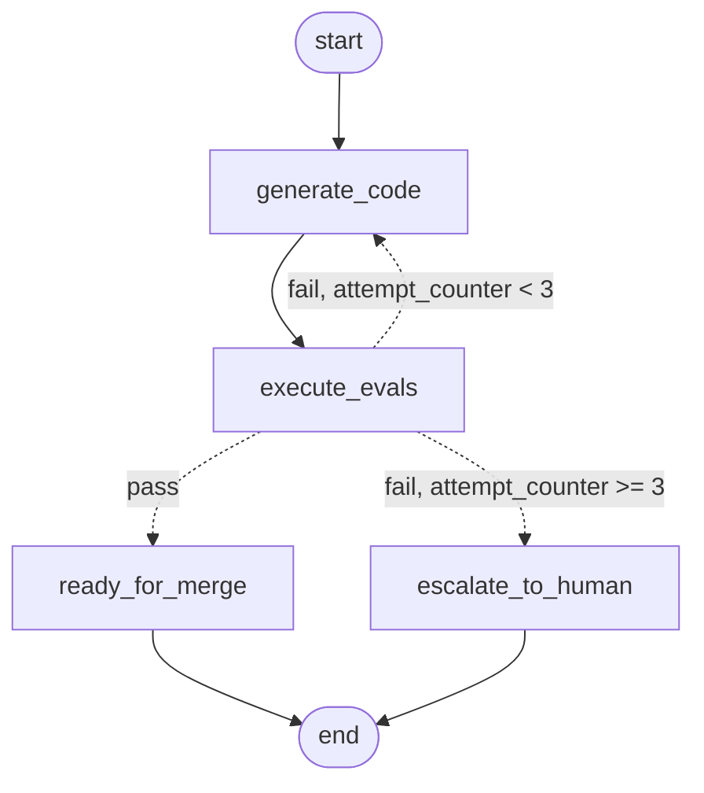

# LangGraph bounded auto-fix loop (prototype)

Standalone prototype of the generate → evaluate → fix loop as a LangGraph state graph. Not wired to any workflow. Decision record: [ADR-0039](../../docs/adr/0039-langgraph-bounded-autofix-prototype.md).



## Run

```bash
cd prototypes/langgraph-loop
pip install -r requirements.txt     # Python ≥ 3.11
python -m unittest -v tests.test_loop   # 13 tests
python loop.py                      # demo + writes loop_graph.mmd (and loop_graph.png, needs mermaid.ink)
```

## Graph

| Node | Kind | Writes |
|---|---|---|
| `generate_code` | LLM (injected) | `generated_code`, `attempt_counter += 1` |
| `execute_evals` | deterministic | `eval_report`: `pass` only if the acceptance suite ran ≥ 1 test, all passed, and the harness printed the per-run nonce (an early exit 0 is `fail`); timeout = fail |
| `ready_for_merge` | terminal | `outcome = "ready_for_merge"` |
| `escalate_to_human` | terminal | `outcome = "needs_human_review"` |

`should_continue` routes after `execute_evals`:

| `eval_report.status` | `attempt_counter` | Next |
|---|---|---|
| `pass` | any | `ready_for_merge` |
| `fail` | `< 3` | `generate_code` (receives the failed report) |
| `fail` | `>= 3` | `escalate_to_human` |
| missing | — | `RuntimeError` (wiring bug) |

## Where the cap is enforced

`MAX_ATTEMPTS = 3` is a module constant — not state, not config, not runtime context.

1. `should_continue` — the routing table above.
2. `generate_code_node` — raises `BudgetExhaustedError` if `attempt_counter >= MAX_ATTEMPTS` or `outcome` is set. With a checkpointer, re-invoking an escalated `thread_id` fails instead of granting new attempts; the graph input (`LoopInput`) cannot carry `attempt_counter` or `outcome`.
3. `recursion_limit = 2 × MAX_ATTEMPTS + 2` as the compiled graph's default config. A caller's `config={"recursion_limit": …}` overrides it: 1 and 2 are the cap, 3 is a backstop.

## Plugging a real LLM

Pass any callable `(issue, previous_code, last_failure) -> code` as `LoopContext.generator`:

```python
app = build_graph(checkpointer=InMemorySaver())
app.invoke(
    {"issue_description": issue, "acceptance_tests": tests},
    config={"configurable": {"thread_id": "issue-42"}},
    context=LoopContext(generator=my_llm_generator, eval_timeout_s=60),
)
```

`last_failure` is `None` on the first attempt, then the last `eval_report` with `status == "fail"`.

## Limits

- Generated code runs **unsandboxed** in a temp dir with the current interpreter. Real use needs an isolated, secret-less job (see ADR-0024): the eval nonce stops an early exit 0, not code that tampers with `unittest` in-process.
- No observability events (ADR-0018), no write guards (ADR-0019/0021/0029), single-file output.
- Cap is per thread; production's is per fix round, reset by APPROVE (ADR-0034).
- CI: `prototype-langgraph` job in `.github/workflows/test.yml` (Python 3.11 and 3.13).
